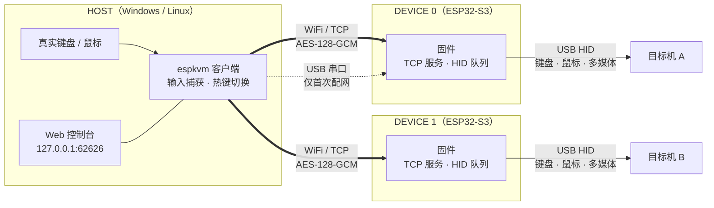
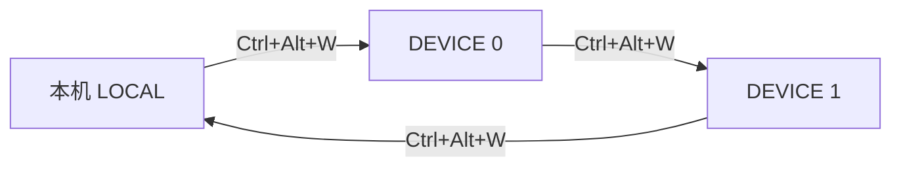

# EspKVM

用一块 ESP32-S3 开发板，把一台电脑上的键盘鼠标通过 WiFi 共享给另一台电脑。被控制的电脑只看到一个普通的 USB 键盘和鼠标，不需要安装任何软件。

## 功能简介

- **一套键鼠控制多台电脑**：按 `Ctrl + Alt + W` 在本机和各台目标机之间循环切换；Windows 上也可以按住 Ctrl 再按鼠标侧键切换（前进键正向、后退键反向）。
- **免驱动的目标机**：ESP32-S3 通过原生 USB 模拟键盘（NKRO，可切换为 BIOS 兼容的 6KRO）、5 键鼠标及纵横滚轮、多媒体键，适用于任意操作系统。
- **加密传输**：客户端与设备之间是单个 TCP 连接，每次连接用设备专属 PSK 派生新的 AES-128-GCM 会话密钥，双向认证。
- **不卡键**：切换、断网、心跳超时（3 s）、USB 重新枚举时，设备都会先释放所有按键和鼠标按钮。
- **目标机睡眠也能切换**：切换完成后，操作键鼠即可远程唤醒目标机。
- **防休眠（可选）**：目标机空闲时由设备定时做微小的鼠标移动，策略可按设备配置。
- **本地 Web 控制台**：`http://127.0.0.1:62626` 提供设备管理、目标切换、热键录入、串口配网和在线配置，需登录（初始密码 `admin`，请立即修改）。

## HOST 与 DEVICE

- **HOST**：插着真实键鼠的电脑（Windows / Linux），运行 `espkvm` 客户端。客户端负责捕获本机输入、热键切换，并把输入发给当前选中的设备。
- **DEVICE**：ESP32-S3 开发板，原生 USB 口插在目标机上（同时供电），UART 口只在首次配网时接到 HOST。每台目标机配一块 DEVICE。

客户端同时与所有已启用的设备保持连接，但同一时刻只有一个目标接收输入。热键按设备列表顺序循环：

切换到远程目标后，本机键鼠输入会被拦截，不再作用于 HOST 自己。活动设备一旦断线或 USB 拔出，客户端立即退回本机。

首次使用流程：在 Web 控制台添加设备（生成 PSK）→ 用 USB 串口给 DEVICE 写入 WiFi、固定 IP 和 PSK → DEVICE 重启联网 → 客户端通过 TCP 认证连接，之后的配置修改都走网络。

## 使用场景

- **一桌多机**：台式机和笔记本、工作机和个人机共用一套键鼠，省去 USB 切换器和多套外设。
- **控制不能装软件的电脑**：公司管控电脑、实验或测试机、工控机，它们只需要接受一个 USB 键鼠。
- **跨系统操作**：从 Windows/Linux HOST 控制 macOS、Linux 或其他系统的目标机。
- **BIOS 与系统安装**：DEVICE 是真实 USB 键盘，能在 BIOS/UEFI 设置和系统安装界面中使用（兼容性取决于目标机固件）。
- **远程开机后保持在线**：配合防休眠策略，让演示机、看板机在无人操作时不进入睡眠。

## 更多文档

- [设计决议](docs/esp32-kvm-decisions.md)：协议、固件、客户端和安全设计的唯一基线
- [源码目录与构建](docs/source-layout.md)：目录结构、CMake 预设、WSL 构建与 Windows 烧录
- [防休眠](docs/keep-awake.md)、[实施状态](docs/implementation-status.md)、[验收记录](docs/validation-2026-11-02.md)

项目处于协议 v2 候选和集成验收阶段，尚未完成实机发布验收。
